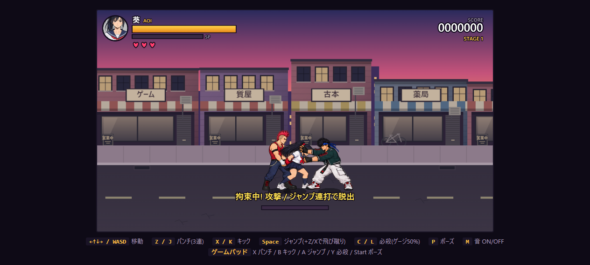
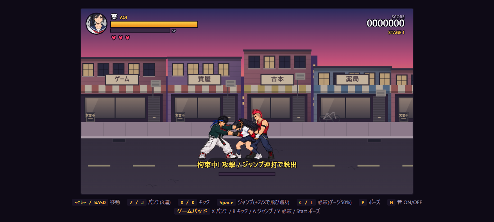
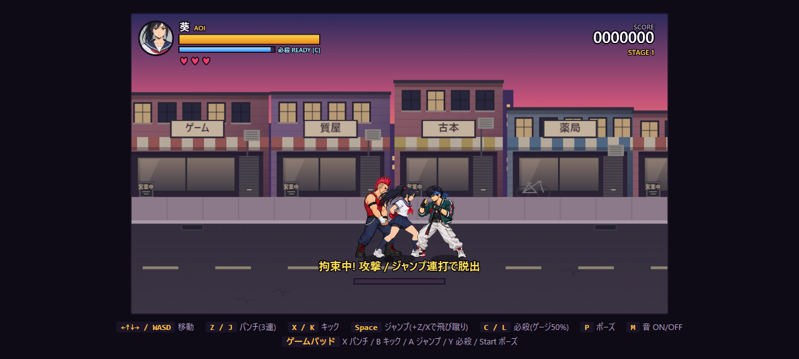

# 追加拘束と腹パン4回

背後の敵が葵を拘束している間、別の通常敵が正面へ近づき、上体を掴んで腹パンを4回出す。チンピラ・ヤンキー・デカブツが対象で、ボスは参加しない。同時に参加できるのは1体、追加拘束は同じ背後拘束につき1回だけ。

成功後30・78・126・174更新目に各6ダメージ、合計24。各命中で10フレーム停止するため、実時間の命中間隔は約0.97秒。210更新目で正面の敵は離れる。命中姿勢は12更新維持し、拳を引き戻してから次を打つ。重い打撃音と小さな画面揺れで一発ずつを強調する。2人の姿勢を同じ時刻から選び、攻撃コマと命中を同期する。正面の敵も攻撃枠を消費し、最初の敵は後ろ手を保持し続ける。

通常の後ろ手拘束は180更新で終了するが、受け付け済みの連撃中は時間切れを保留して4発を完了する。連打8入力による脱出はいつでも可能。被弾による画面停止中も脱出入力を受け付ける。背後の敵の被弾・撃破、葵のHP0、ステージ変更で双方を解除する。正面の敵の被弾・撃破では追加拘束と連撃だけを中断する。葵への通常ダメージでは後ろ手拘束を解除しない。

## 新しい画像

葵は追加拘束・身構え・腹への被弾・回復姿勢、敵は上体を掴む・拳を引く・低いパンチ・引き戻す姿勢を各4コマ制作。16コマの新素材。通常の体格を基準に同じ倍率で切り出し、足元の中心を基準点にする。ヤンキーの青緑の上着、チンピラの個体別色は既存の色処理を共用。大男は葵との身長差に合わせて低い位置へ打つ専用原本を追加。

- 実行時: [葵](../assets/characters/aoi_assist_v1.png)、[チンピラ](../assets/characters/thug_assist_v1.png)、[ヤンキー](../assets/characters/yankee_assist_v1.png)、[デカブツ](../assets/characters/brute_assist_v1.png)
- 内蔵ImageGenで制作した原本: [共通原本](../source_art/character-v2/assist-combo-source.png)、[デカブツ原本](../source_art/character-v2/brute-assist-source.png)
- 正確な生成指示・参照・生成履歴: [共通](../source_art/character-v2/assist-combo-provenance.json)、[デカブツ](../source_art/character-v2/brute-assist-provenance.json)
- 再切り出し: `python tools/pack_assist_sheet.py`
- サイズ・倍率・SHA256: [検証記録](../assets/characters/assist-validation.json)

比較画面の「追加拘束・腹パン4回」で双方の素材を確認できる。生成素材には姿勢ごとの手の接触位置の小さな差が残る。

## 確認

Node36件・Python9件が成功。正面からのみの追加拘束、1体制限、4発の時刻とダメージ、繰り返し防止、脱出、双方の割り込み、死亡・ステージ変更時のリンク清掃、時間切れの保留、命中コマとの同期、画面停止中の入力を検証。全素材の透明度・ハッシュ・フレーム範囲・基準高さも確認。

実ブラウザーで3種の表示スタイル×左右の6通りを、実ゲームの更新処理を使った固定配置で確認。各回HP100→76、命中4回、正面の拘束リンク解除を確認。実キーZの8回入力で双方の拘束が解ける。比較画面の新項目が表示され、ブラウザーエラーなし。CIは未設定。

## 手元の重なり修正

葵の後ろ手（赤いグローブと手首）を敵より手前に重ねて描き直し、敵の手で消えないようにした。画像そのものは変更せず、現在のポーズ・向き・基準点・もがきに一致する範囲だけ再描画する。左右と通常の後ろ手拘束、腹への被弾姿勢で確認した。

