# 追加拘束と腹パン4回

チンピラの後ろ手拘束中の葵は、通常拘束と同じ体格・待機姿勢を使う。
腹パンの瞬間だけ、後ろ手と接地を維持して上半身を少し折り、目を閉じる専用画像へ切り替える。
以前の小さな倍率と深いしゃがみを廃止し、打撃側の間合いも近づけて腹への接触を合わせた。
[採用原本](../source_art/character-v2/aoi-assist-grounded-v2-source.png)、[正確な編集プロンプト](../source_art/character-v2/aoi-assist-grounded-v2-provenance.json)。
左右の準備/命中、4発でHP100→76、終了後ダウンをローカルブラウザーで確認。Node60件・Python11件通過。

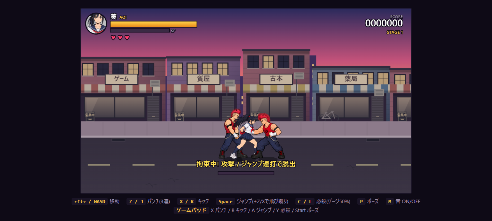
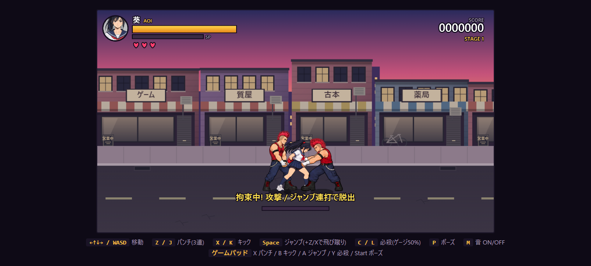
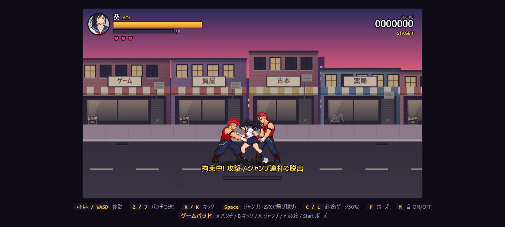

背後の敵が葵を拘束している間、別の通常敵が正面へ近づき、上体を掴んで腹パンを4回出す。チンピラ・ヤンキー・デカブツが対象で、ボスは参加しない。同時に参加できるのは1体、追加拘束は同じ背後拘束につき1回だけ。

成功後30・78・126・174更新目に各6ダメージ、合計24。各命中で10フレーム停止するため、実時間の命中間隔は約0.97秒。210更新目で正面の敵は離れる。4発完了した場合は背後の拘束も解除し、葵はその場でダウンする。吹き飛ばし・追加ダメージ・無敵時間は付けず、通常のダウン→起き上がりに移る。途中の脱出や中断ではダウンしない。命中姿勢は12更新維持し、拳を引き戻してから次を打つ。重い打撃音と小さな画面揺れで一発ずつを強調する。2人の姿勢を同じ時刻から選び、攻撃コマと命中を同期する。正面の敵も攻撃枠を消費し、最初の敵は後ろ手を保持し続ける。

通常の後ろ手拘束は180更新で終了するが、受け付け済みの連撃中は時間切れを保留して4発を完了する。連打8入力による脱出はいつでも可能。被弾による画面停止中も脱出入力を受け付ける。背後の敵の被弾・撃破、葵のHP0、ステージ変更で双方を解除する。正面の敵の被弾・撃破では追加拘束と連撃だけを中断する。葵への通常ダメージでは後ろ手拘束を解除しない。

## 新しい画像

葵は追加拘束・身構え・腹への被弾・回復姿勢、敵は上体を掴む・拳を引く・低いパンチ・引き戻す姿勢を各4コマ制作。16コマの新素材。通常の体格を基準に同じ倍率で切り出し、足元の中心を基準点にする。ヤンキーの青緑の上着、チンピラの個体別色は既存の色処理を共用。大男は葵との身長差に合わせて低い位置へ打つ専用原本を追加。

- 実行時: [葵](../assets/characters/aoi_assist_v1.png)、[チンピラ](../assets/characters/thug_assist_v1.png)、[ヤンキー](../assets/characters/yankee_assist_v1.png)、[デカブツ](../assets/characters/brute_assist_v1.png)
- 内蔵ImageGenで制作した原本: [共通原本](../source_art/character-v2/assist-combo-source.png)、[デカブツ原本](../source_art/character-v2/brute-assist-source.png)
- 正確な生成指示・参照・生成履歴: [共通](../source_art/character-v2/assist-combo-provenance.json)、[デカブツ](../source_art/character-v2/brute-assist-provenance.json)
- 再切り出し: `python tools/pack_assist_sheet.py`
- サイズ・倍率・SHA256: [検証記録](../assets/characters/assist-validation.json)

比較画面の「追加拘束・腹パン4回」で双方の素材を確認できる。生成素材には姿勢ごとの手の接触位置の小さな差が残る。

## 確認

Node36件・Python9件が成功。正面からのみの追加拘束、1体制限、4発の時刻とダメージ、繰り返し防止、脱出、双方の割り込み、死亡・ステージ変更時のリンク清掃、時間切れの保留、命中コマとの同期、画面停止中の入力を検証。全素材の透明度・ハッシュ・フレーム範囲・基準高さも確認。

実ブラウザーで3種の表示スタイル×左右の6通りを、実ゲームの更新処理を使った固定配置で確認。各回HP100→76、命中4回、正面の拘束リンク解除を確認。実キーZの8回入力で双方の拘束が解ける。比較画面の新項目が表示され、ブラウザーエラーなし。CIは未設定。

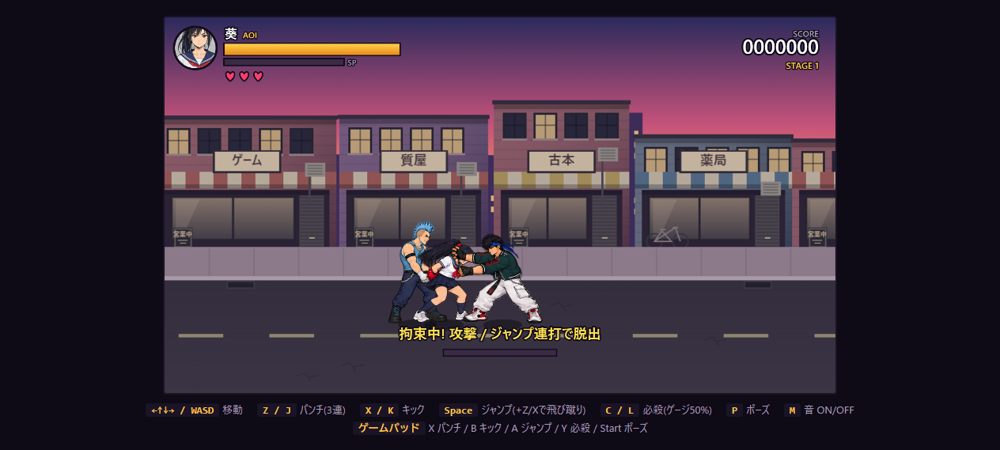
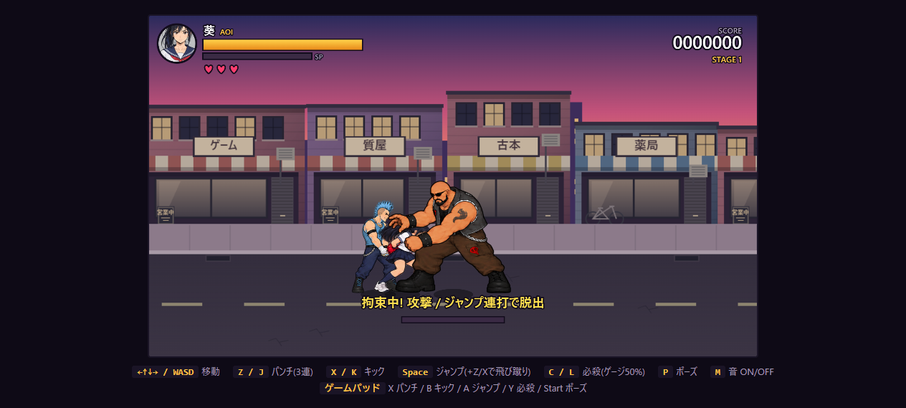
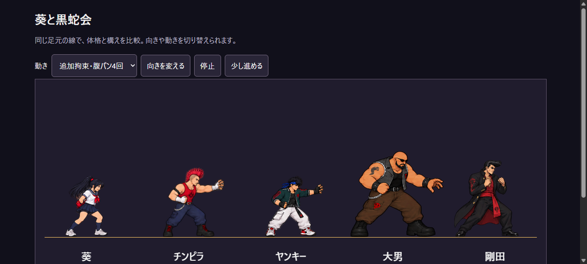

## 顔に重なる押さえ手の修正

正面の敵が伸ばす押さえ手が葵の顔に被っていた。チンピラとヤンキーの4ポーズずつの押さえ腕を下げ、さらに敵の押さえ腕が葵の頭の後ろを通る描画にした。前かがみの被弾姿勢も顔を見せる。前回の手首を手前に描く処理は撤去した。重い打撃の間隔と合計ダメージは維持。

内蔵ImageGenで既存原本を編集し、チンピラ・ヤンキーの行だけ採用。葵・デカブツの素材は既存のまま。原本は [assist-shoulder-source.png](../source_art/character-v2/assist-shoulder-source.png)、正確な編集指示は [assist-shoulder-provenance.json](../source_art/character-v2/assist-shoulder-provenance.json)。実行時は既存の `thug_assist_v1.png` と `yankee_assist_v1.png` を更新し、画像とフレーム情報にキャッシュ更新番号を付けた。

実ブラウザーでヤンキーの左右・チンピラ・デカブツの被弾姿勢を確認。Node36件・Python9件が通過。

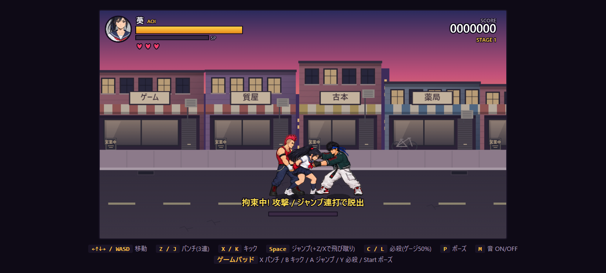
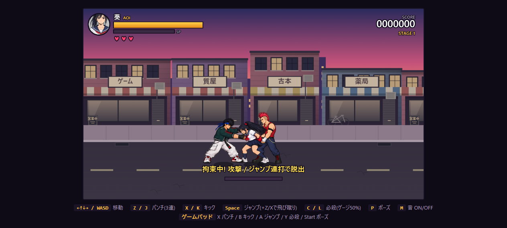

## 連撃終了後のダウン

Node36件が通過。実ゲームの更新処理で敵3種×左右の6通りを確認し、4発・HP76・両拘束解除・地上ダウンを確認。続けて起き上がりへ進むことも確認。

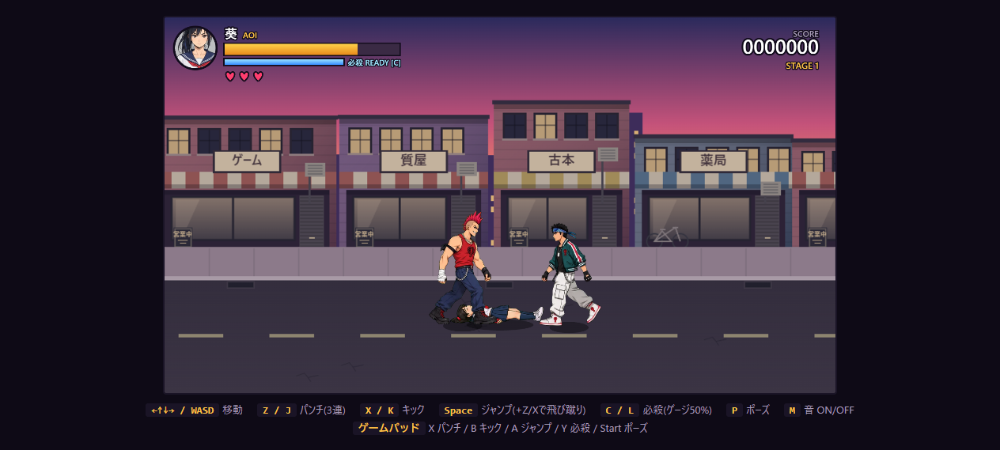

## 押さえ手のはみ出しと第三者の描画

葵の頭の重ね描画が全員を描いた後だったため、手前に来た無関係の敵まで葵の頭で欠けて見えていた。背後の敵・葵・正面の敵をひと組として奥行き順に描き、その組の中で頭の前後関係を完結させた。手前の無関係な敵はその後で描く。

押さえる手のはみ出しは、正面の敵自身の描画にだけ偶奇クリップを適用して隠す。共有画面を消去する処理は使わず、クリップは保存・復元でその1回の描画に限定する。腹パンの拳は残す。新規画像生成は行っていない。

Node46件・Python9件が通過。拘束組と第三者の描画順、左右反転、クリップ後の状態復元、共有画面を消さないことを検証。実ブラウザーでは敵3種×左右×4ポーズの24通りを描画し、エラーなし。手前に重なった敵の姿と、チンピラ・デカブツの手の非表示を実画像で確認。

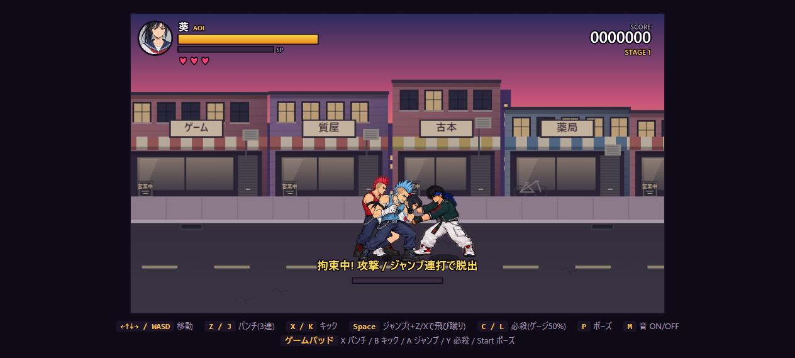
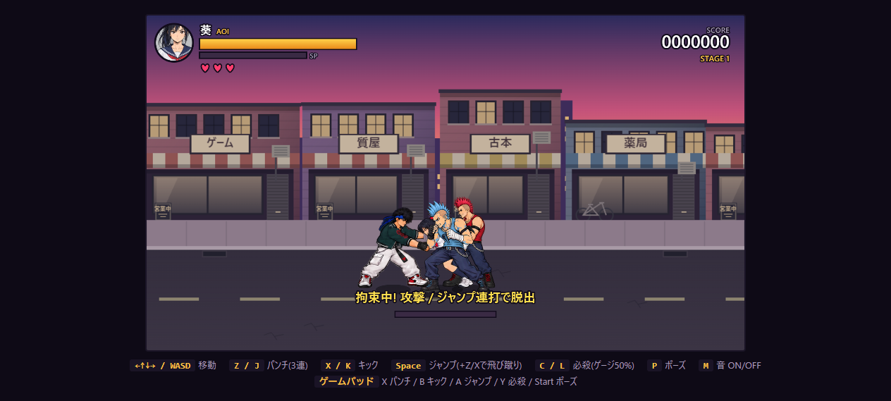
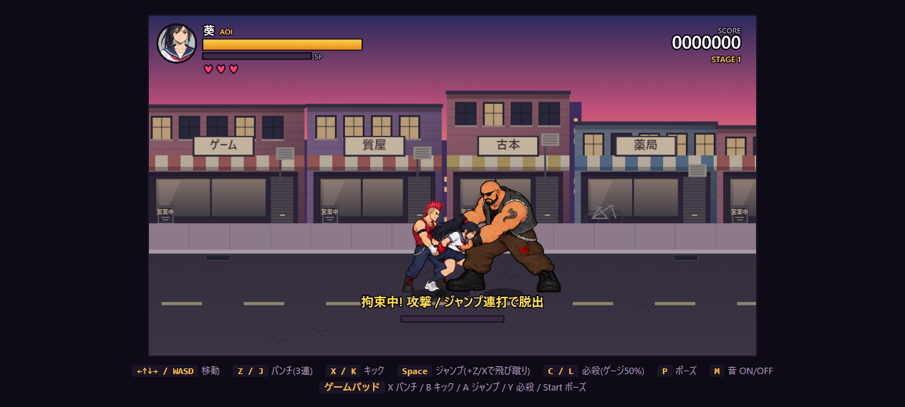
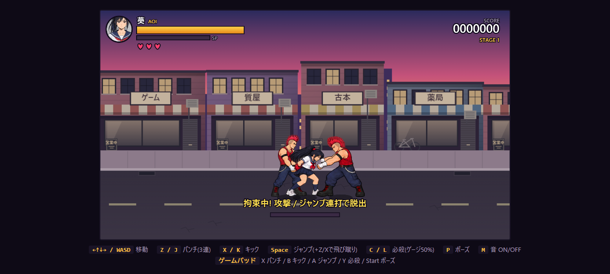
