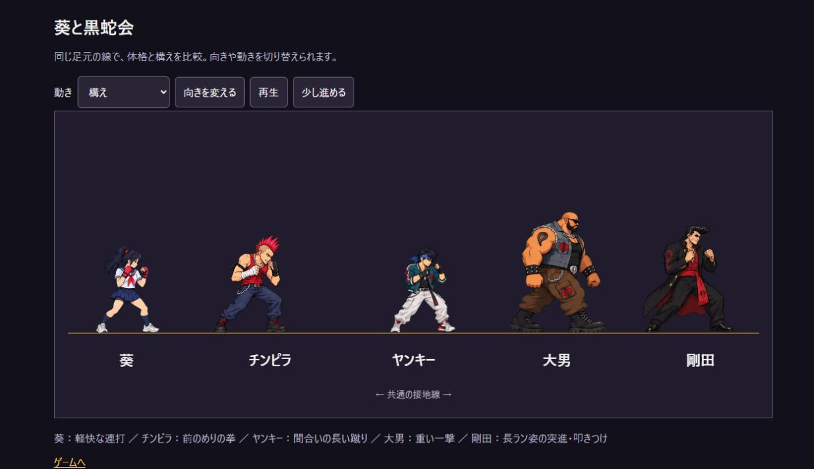
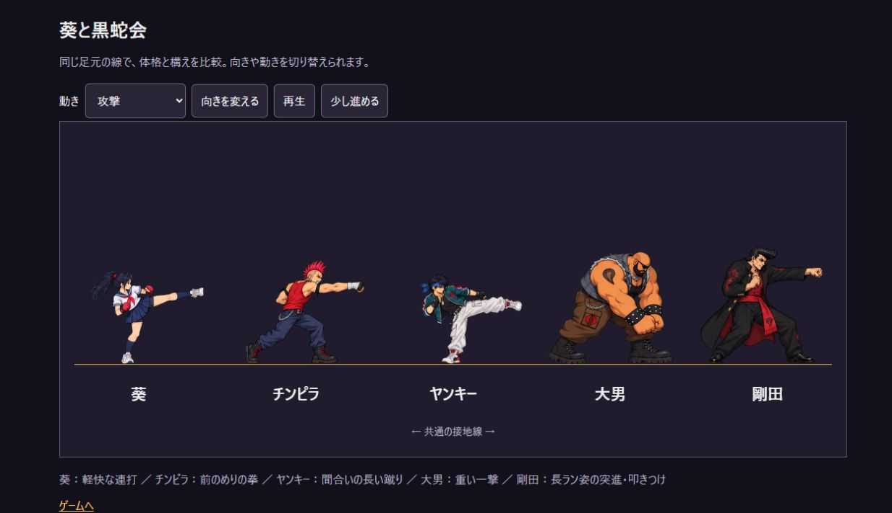
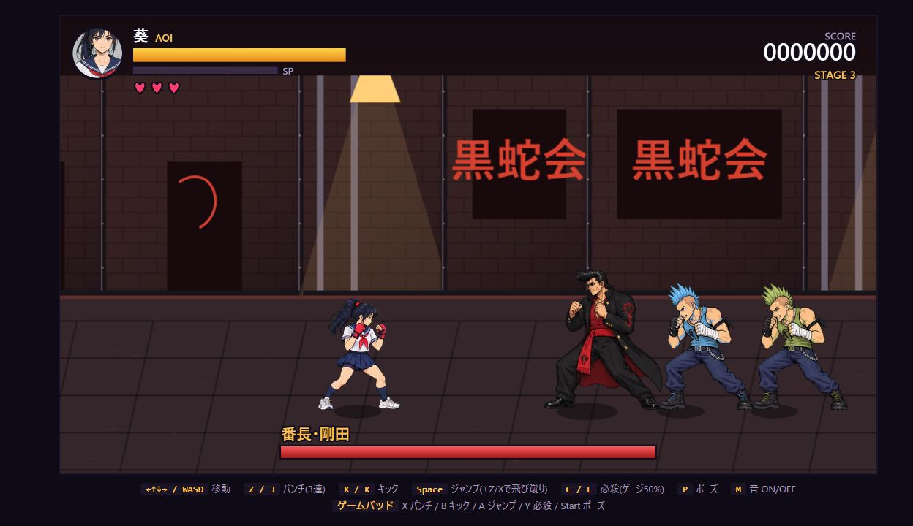
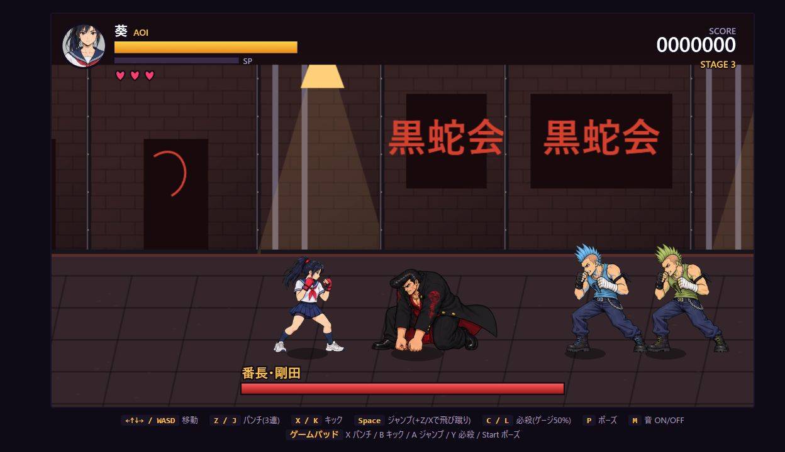

# キャラクターの見直し — 2026-10-10

立ち姿の見た目だけでなく、攻撃を見て役割を判断できるようにした。体力・移動速度・攻撃判定・ダメージ・敵AIの値は変更していない。

| キャラクター | 表現 |
|---|---|
| 葵 | セーラー服・赤いグローブ・ポニーテールを維持。基本攻撃16コマを更新。歩きは4コマ版に違和感があったため従来の8コマ構成に戻した。拳を引く、伸ばす、戻す、アッパー、横蹴りを既存の判定時間に合わせる |
| チンピラ | 赤いモヒカン・タンクトップ。前のめりの構え、拳を大きく引く攻撃、被弾・ダウン・起き上がりを更新。色違いも維持 |
| ヤンキー | 青緑のジャケットと白系カーゴ。膝を抱える予備動作から横蹴りに移る。既存の蹴り判定がパンチに見えていた問題を修正 |
| 大男 | 既存の重い体格と両手を頭上に上げる構えを維持。ほかの敵の姿勢との差を明確化し、ゆっくりした呼吸を追加 |
| 番長・剛田 | 3Dマネキンを2Dの長ラン・リーゼント・赤い帯へ置換。歩行・拳・突進・叩きつけ・被弾・倒れる・起き上がりを追加 |

## 実装と素材

- `character-lab.html` で構え・歩き・攻撃・被弾・ダウン・起き上がり・ボスの大技を切り替え、停止・送り・左右反転ができる。比較用の時間進行はゲームの実戦速度とは異なる。
- ゲームと比較画面は `character-motion.js` の体格・呼吸・敵ポーズ選択を共用。待機の異なる2枚を往復する震えを避け、足元を固定した微小な呼吸にする。
- 歩行と戦闘の頭の見え方を実画面で比較し、しゃがんだ戦闘姿勢の高さだけを基準に拡大しないよう調整した。葵の旧被弾・ジャンプ素材には従来の倍率補正を残す。
- 6シート、計76コマ。生成元PNGとプロンプト・参照・切り出しレシピを保存。中間画像と歩行用の技術的な骨格ガイドも記録。
- ネイティブの透明度は再度色抜きせず維持。緑背景のシートだけ色抜きと縁の緑除去を実施。連結領域で切り出し、全コマを共通倍率で縮小し、元画像と出力のSHA256を記録。
- 全キャラが2Dになり、ゲームはThree.js・3Dモデルを読み込まない。旧ファイルは保存。素材欠落時は従来の簡易描画を使い、透明な敵にならない。

## 確認

- Node.js: 7件成功。色違いで肌・輪郭・白・透明度を保持、攻撃判定開始時の姿勢、ボスの突進と叩きつけの予備動作、ダウン・起き上がりを確認。
- Python: 5件成功。元の透明度、白や肌を残す色抜き、しゃがみを拡大しない倍率、欠落コマの拒否、全アトラスのハッシュ・範囲・余白の透明度を確認。
- 実ブラウザでボスの待機・歩行・予備動作・攻撃・被弾・ダウン・起き上がりを左右両向き、3攻撃・複数時刻で252回描画。剛田の叩きつけの命中姿勢を目視確認。
- 実キー入力からゲーム開始・右移動・パンチ・キック・ジャンプを確認。右移動で座標と歩行位相が進み、各攻撃状態に入ることを確認。
- ボス戦闘PNGをブラウザで遮断。20秒の待機後、Enterから開始でき、ボスが簡易描画で残ることを確認。
- 390×844のタッチ表示で「決定」から開始。横はみ出しなし、方向50px・攻撃48px以上。通常URLでデバッグAPIとThree.jsが未公開、コンソールのエラー・警告なし。
- 既存の背景・小画面改善の記録は [前回の確認](../visual-review/README.md) を参照。そこにあるボス画像は2D化前の履歴。

## 残る限界

生成素材の歩行は左右の足の前後関係が弱く、厳密な接地と左右交互の歩行を保証する手描き素材には達していない。輪郭や衣装の細部にもコマ間の揺れがある。葵の被弾・ジャンプ、一般敵の歩行と大男は旧素材を使用。物理スマホでの操作感と、通常プレイによる全ステージクリアは未確認。画像は目視レビュー用で、固定条件の画素差検証や sealed run evidence ではない。

## 歩行の修正
ユーザーによる実プレイで、葵の新しい4コマ歩行の違和感が増していた。左右の足の区別が弱いまま接触・通過を繰り返し、1周40更新の再生になっていた。ゲームと比較画面を従来の歩行画像・8コマ順・倍率に戻し、ゲームの1周を約62更新へ復元。4コマ素材は不採用の試作として保存する。上の立ち姿・攻撃画像はそのまま有効。
