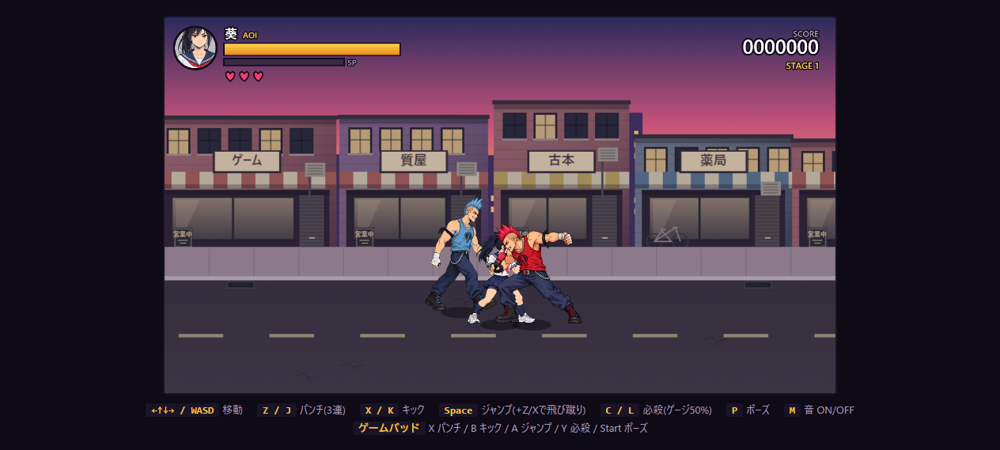

# 複数の敵の回り込み

別の生存敵が予備動作または攻撃をしている間、待機・移動中の敵は葵の横へ約48移動してから背後へ回る。背後に着けば通常の攻撃や背後拘束を選べる。担当敵の攻撃が終わっても最長180更新は回り込みを継続し、攻撃待ちの間も背後側を維持する。

左右の向きと画面端を考慮し、背後に空間がない場合は通常AIを使う。味方が全滅すれば回り込みをやめる。葵の拘束中は既存の追加拘束AIを使い、ダウン・死亡・起き上がり・ゲームオーバーでは回り込みをしない。

Node42件・Python9件が通過。左右の迂回経路、背後への到達、攻撃間の継続、壁際、味方の死亡、拘束・ダウンとの共存をテスト。実ブラウザーでは正面の敵を攻撃中に固定し、もう1人が左右とも約45離れた横の経路を通り、184更新で背後へ到達した。

