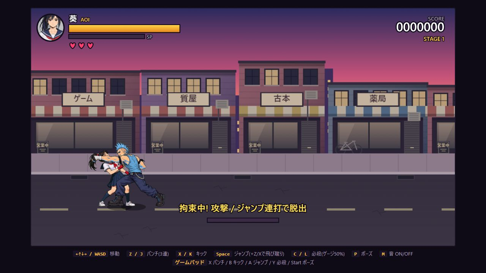
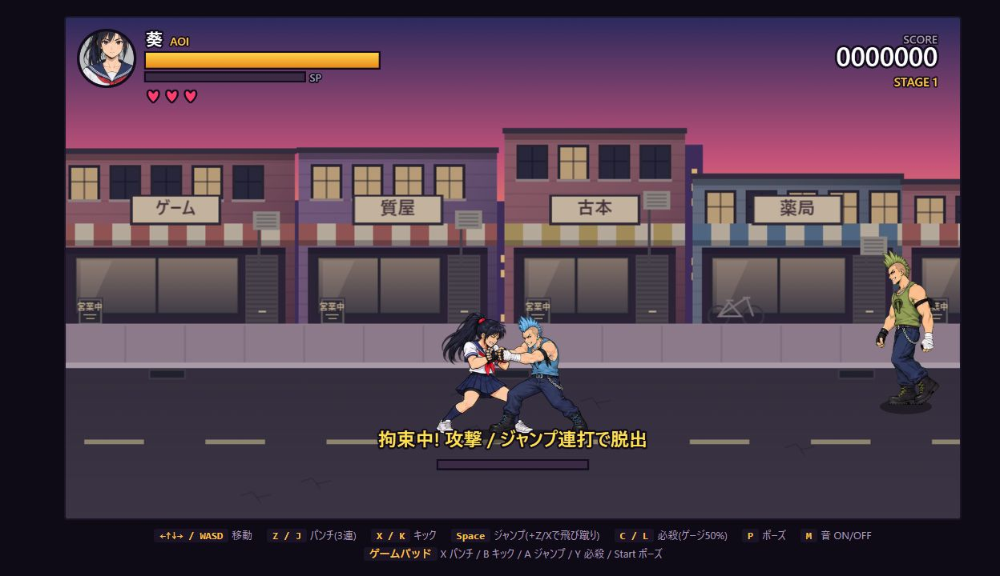
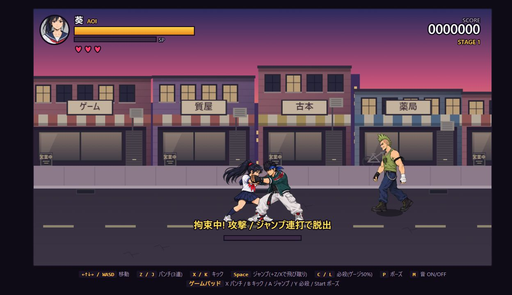
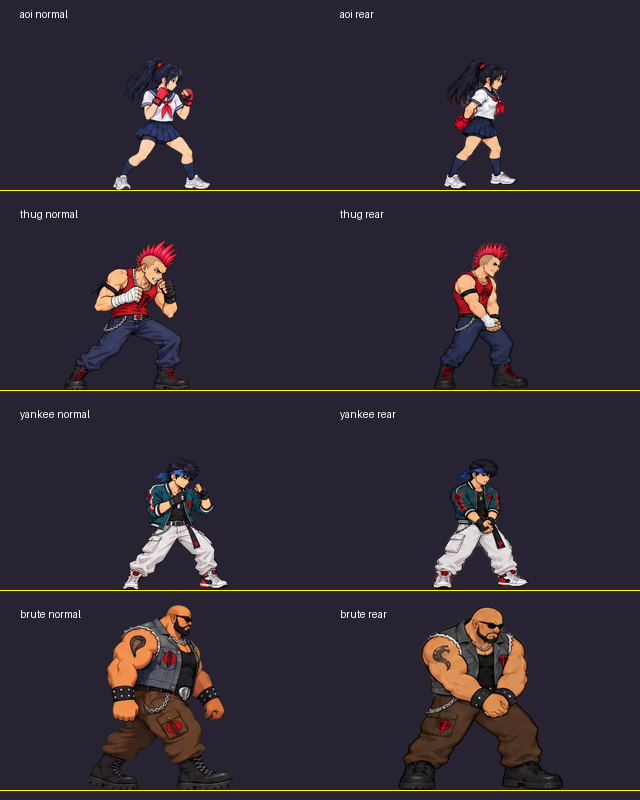
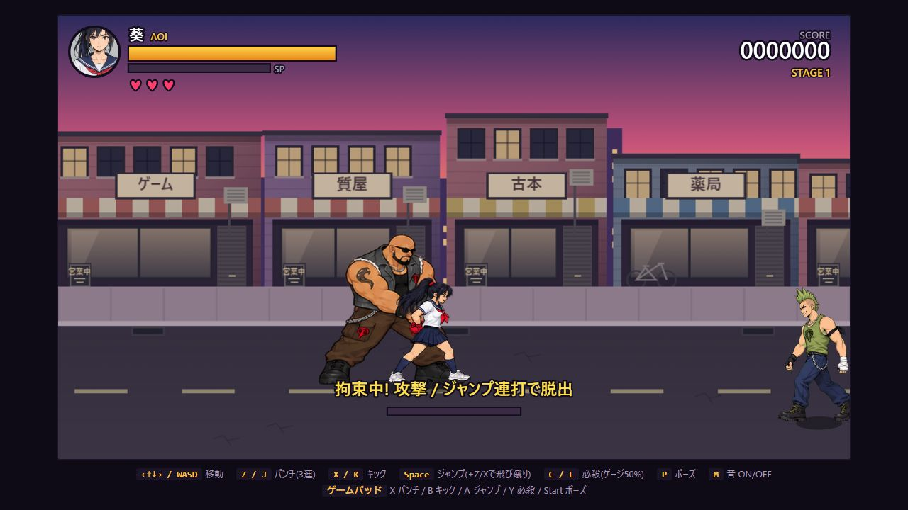
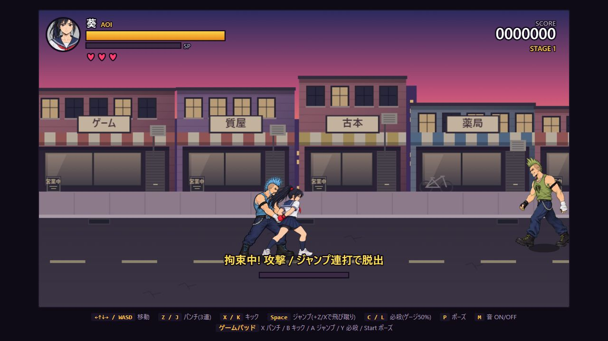

# 敵の拘束技

チンピラ・ヤンキー・デカブツが攻撃選択時に25%の確率で拘束を選ぶ。予備動作・予告文字なしで、近距離・同じ奥行きにいる地上の葵をその更新から拘束する。空中や間合いの外には届かない。

投げ・拘束自体のダメージ・無敵付与はない。最大180更新（通常約3秒）、パンチ・キック・ジャンプ・必殺ボタンの8回の新規入力で早期脱出。長押しでは進まない。拘束中は案内と脱出ゲージを表示する。

拘束する敵が攻撃枠を1つ使う。他の敵の攻撃は当たり、その命中時には拘束を解除して通常の被弾処理へ移る。拘束者の被弾・撃破、ステージ切り替えでも解除。脱出後300更新は再拘束されないが、通常攻撃に対する無敵は付かない。

葵と敵3種に専用の拘束素材を使用。詳細は下記。

検証: Node 21件・Python 7件成功。実ブラウザーでチンピラの予告→拘束、HP100の維持、Zを8回入力して脱出、脱出直後inv=0を確認。警告・エラーなし。

## 衣装と待機画像の統一

ヤンキーの個体別の色替えをやめ、歩行と戦闘の青緑・青寄りの上着を共通の青緑パレットに揃えた。肌・白いパンツ・赤いライン・輪郭・透明度は保持。生成素材にある線や服の形の差は残る。

全員の待機表示を1コマに固定。葵は構えの3番、敵は戦闘シートの0番だけを使用し、待機中の拡縮も停止。素材原本にある別の待機コマは履歴として保持し、表示には使わない。ゲームと比較画面に反映。

検証: Node23件・Python7件成功。比較画面で全員の待機、ヤンキーの歩行と攻撃を確認。警告・エラーなし。

## 専用拘束モーション

内蔵ImageGenで4人×4コマの透過素材を制作。敵は手を伸ばす・握る・押さえ続ける・手を離す、葵は掴まれる・抵抗2姿勢・振りほどいて構える。番長は拘束技を持たないため対象外。

`assets/characters/*_restraint_v1.png` と同名JSに切り出し、ゲームと比較画面に組み込み。拘束中は2姿勢を切り替え、解除後12更新は解放姿勢を表示する。解除直後も操作可能。別の攻撃・被弾になった場合はその姿勢を優先する。素材欠落時は従来の描画へ戻る。

生成元・正確なプロンプト・参照は `source_art/character-v2/restraint-provenance.json`、透過原本は `restraint-source.png`。`python tools/pack_restraint_sheet.py` で再切り出しできる。透明度を保持し、キャラクターごとに共通倍率を使う。ヤンキーの衣装色処理も共有。ハッシュとフレーム数は `assets/characters/restraint-validation.json` に保存。

検証: Node24件・Python8件成功。実ゲームでチンピラの予告から拘束、3種×左右の6通りの描画、Z8回で双方が解除姿勢へ移行してHP100・inv0を維持することを確認。比較画面の拘束モードも確認。生成素材なので接触位置には姿勢間で数pxのずれが残る。

## 即時発動への調整

拘束技の予備動作と「掴む!」表示を削除。選択後、間合いに入った更新で直接命中判定を行い、windupを経由しない。通常攻撃の予備動作は従来どおり。比較画面も保持姿勢から始まる。自動テストで敵AIの最初の1更新から拘束に移ることを確認。Node25件・Python8件成功。

## 後ろ手への変更と体格修正

正面の拘束を、敵が葵の背後から後ろ手を押さえる姿勢へ変更。両者は同じ向きを向き、敵を先に描画して葵を前に置く。敵3種と葵に後ろ手専用の4コマ素材を制作し、v2として追加。予備動作なしの発動・8入力脱出・無敵なしは維持。

前版はしゃがんだ姿を全身高さで合わせており、拘束時の敵の頭身が通常と揃わなかった。今回は立ち姿に近い素材へ変更し、通常の戦闘コマと同じ基準高さ（葵264・チンピラ300・ヤンキー300・デカブツ331）で切り出し。ゲーム内の個体倍率は通常と同じ。通常と拘束の頭・肩・足元を並べて目視確認し、保持姿勢の高さが通常の±10%以内であることもテストする。

生成原本は `source_art/character-v2/restraint-rear-source.png`、初回生成は `restraint-rear-initial.png`。プロンプト・参照・レイアウト修正指示を同ディレクトリの `restraint-rear-provenance.json` と `restraint-rear-layout.json` に記録。現在の再切り出しツールはv2を出力する。旧v1素材は原本とともに保持し、実行時には使わない。

検証: Node26件・Python8件成功。3種×左右の6通りで同方向・背後配置を確認。Z8回で解放姿勢へ移り、HP100・inv0を維持。ブラウザー警告・エラーなし。手の接触には姿勢間でわずかなずれが残る。

## 葵の品質見直しと背後限定

葵だけを大きな4コマ素材で描き直し、肩・肘・手首のつながり、2つのグローブ、服の線を見直した。実行時は `aoi_restraint_v3.png/js` を使用。生成元と正確な指示は `source_art/character-v2/aoi-restraint-rear-v3-source.png` と同名のprovenance JSONに保存。両足の高さが微妙に異なる場合も中心がずれないよう、足元の基準点は下端12pxではなく足元12%の両足から算出する。

拘束は敵が葵の背後に8px以上離れており、横44px・奥行き16px以内にいる場合のみ成立。葵の向きを保持する。敵AIも正面では拘束を選ばず、予定していた拘束が振り向きで正面になった場合は通常攻撃へ切り替える。判定時に背後条件を再確認するため、正面から後ろへ回り込むような強制配置は発生しない。

検証: Node27件・Python8件成功。実ブラウザーで3種×左右の6通りの正面不成立・背後成立・向き維持を確認。8回入力で脱出しHP100・inv0を維持。警告・エラーなし。後ろ手の手首が重なる部分には生成素材としての細部の曖昧さが残る。

## 拘束中の小さな抵抗
拘束中の葵と敵は1枚の保持ポーズを使用する。葵だけを手首付近を軸に最大約1.4度、約0.55秒周期で小さく揺らし、控えめに身をよじる様子を表す。開始8フレームで揺れをなじませ、解放時に停止。判定・座標・敵の体格は変更しない。比較画面も同じ表現に統一。
