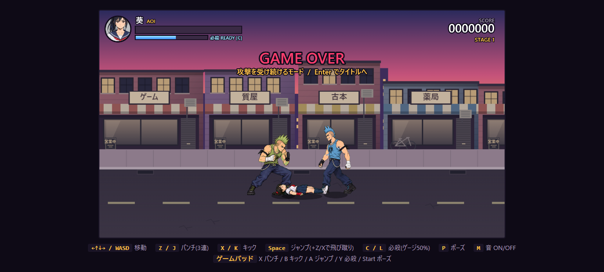

# ゲームオーバー後の攻撃継続

最後の残機を失うと、ゲームオーバー表示を出しながら戦闘の更新を継続する。HPと残機は0のまま。葵は操作できず、敵の通常攻撃を受け、倒れたまま打撃を受け続ける。HP0を再び死亡条件として扱わないため、残機が減り続けたり画面が止まったりしない。HP0では拘束は成立せず、背後の敵も通常攻撃を選ぶ。

回復アイテムは拾わず、スコア・ウェーブ・ステージ進行は停止する。敵が全滅した場合はチンピラを1体用意する。画面を暗転させず、上部に GAME OVER と終了方法を表示する。Enterでタイトルに戻り、再開時は通常のHP100・残機3・操作可能な状態へ戻る。P/Escapeの一時停止、Mの消音は利用できる。

## 確認

Node42件・Python9件が通過。ゲームオーバー中の更新継続、アイテム回復とステージ進行の停止、Enterによる終了、HP0でダウンを保持すること、通常の死亡処理、モード開始時の初期化、敵の補充、操作の無効化をテスト。

実ブラウザーで最後の残機からモードへ遷移し、900更新中に13回の被弾を確認し、全更新でダウン状態・同じ位置・地上を維持。HP0・残機0・ゲームオーバーモードを維持。実キーEnterでタイトルへ戻り、再開時HP100・残機3で通常プレイに戻ることを確認。ブラウザーエラーなし。

ダウン中の命中は敗北後の葵だけに適用。通常プレイのダウン・起き上がり中や敵のダウンへの命中判定は変えない。攻撃1回につき1回命中し、低い位置の火花と既存の被弾音声が出る。吹き飛ばし・起き上がり・残機減少は発生しない。
