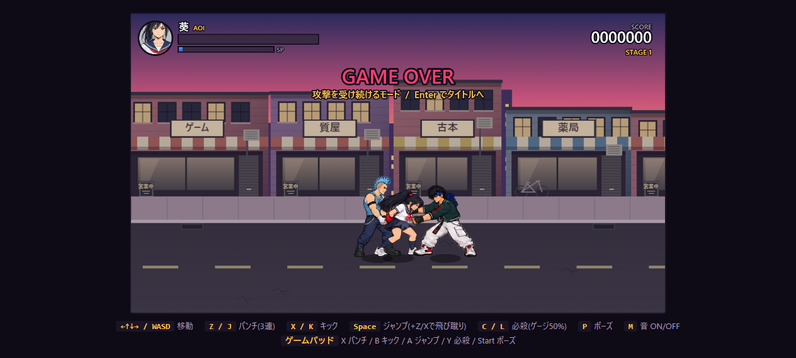
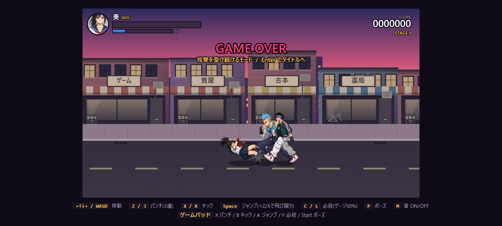

# ゲームオーバー後の攻撃継続

最後の残機を失うと、ゲームオーバー表示を出しながら戦闘の更新を継続する。HPと残機は0のまま。葵は操作できず、ダウンを基本姿勢として攻撃を受け続ける。

通常打撃では攻撃方向にほどよく吹き飛ぶ。横速度は2〜5、上向き速度は通常3.2・強い攻撃4.2に制限し、既存の物理処理で着地する。画面外へ出ないよう位置を制限する。着地後は起き上がらずダウンを維持する。

地面にいるときは背後からの拘束が成立する。別の敵が正面へ来ると追加拘束・腹パン4回を行い、HP0でも途中で解除されない。拘束中の通常被弾でも拘束を維持する。4連撃完了後または拘束の時間切れではダウンに戻る。吹き飛んでいる途中は掴まれない。通常プレイでは従来どおりHP0で拘束を解除する。

回復アイテムは拾わず、スコア・ウェーブ・ステージ進行は停止する。敵が全滅した場合はチンピラを1体用意する。画面を暗転させず、上部に GAME OVER と終了方法を表示する。Enterでタイトルに戻り、再開時は通常のHP100・残機3・操作可能な状態へ戻る。P/Escapeの一時停止、Mの消音は利用できる。敗北後は脱出入力も無効なので、連打案内は表示しない。

## 確認

Node44件・Python9件が通過。通常死亡と敗北モードの分離、ダウン中の命中、攻撃1回につき1回の命中、吹き飛ばしの上限と着地、左右×敵3種のHP0拘束・腹パン4回・連撃後と時間切れのダウンをテスト。

実ブラウザーで最後の残機からゲームオーバーへ遷移し、背後拘束→追加拘束→4発→ダウンを確認。HP0・残機0を維持。通常打撃では横速度-2.8・上向き速度3.2を確認し、x480→約441へ移動して着地、ダウンを維持した。ブラウザーエラーなし。

## 吹き飛ぶ方向

敗北後の吹き飛ばし方向は攻撃者の向きを使う。近距離で攻撃者と葵の中心位置が重なったり、数ピクセルだけ前後が入れ替わったりしても逆に飛ばない。通常プレイの吹き飛ばしは変更しない。

左右と0・5ピクセルの重なりを回帰テストで確認。実ブラウザーでも中心が5ピクセル重なる攻撃で、左向きでは横速度-2.8・x480→約461、右向きでは横速度2.8・x480→約499となることを確認。Node46件が通過。
