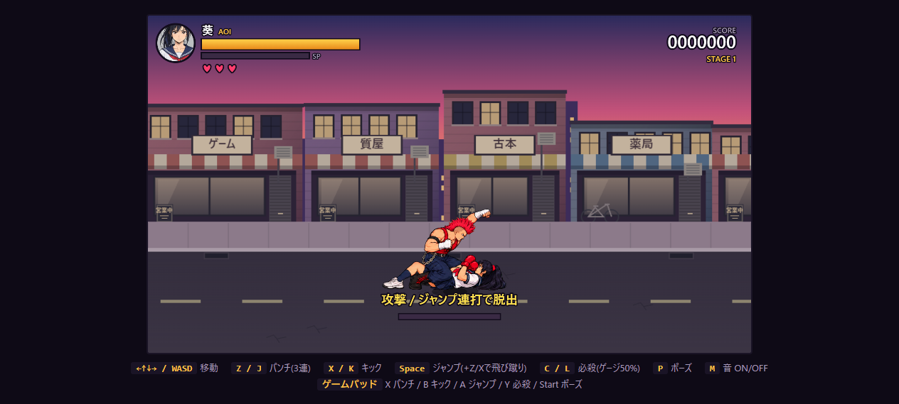
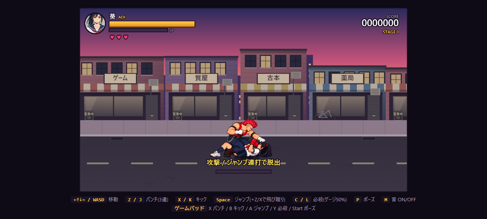
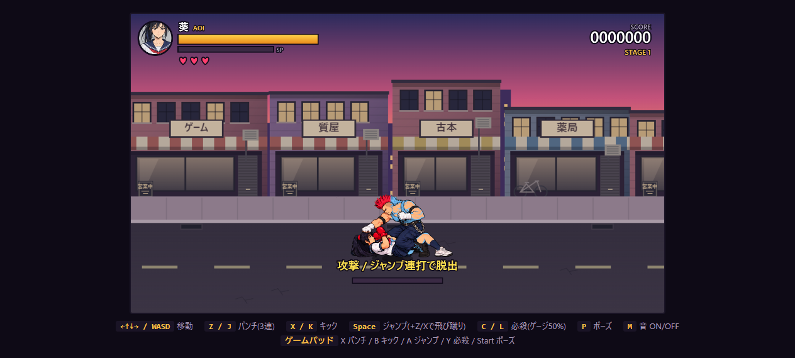

# チンピラのマウントタックル

チンピラは正面の葵に42更新（0.7秒）のタメを見せ、向きを固定してタックルする。
立っている葵とダウン中の葵が対象。横移動・ジャンプ・起き上がりで回避でき、外した後は120更新待つ。
通常の攻撃選択時は22%でタックルを選び、ダウン中はタックルを優先する。

通常の葵は、接地してから移動・パンチ・キック・ジャンプ・必殺技のいずれかを新しく押すと起き上がる。
入力なしではダウンを維持する。ゲームオーバー後は従来どおり起き上がり操作を無効にする。

捕まると馬乗りになり、36 / 90 / 144 / 198更新で顔面へ4発、各6ダメージ。
一発ごとに8更新の停止と重い打撃音を入れる。234更新で離れ、葵はダウンへ戻る。
通常時は攻撃・ジャンプ・必殺技の新しい入力8回で途中脱出可能。押しっぱなしは加算しない。
打撃の停止中も入力を受け付ける。解除後240更新は再マウントを防ぐ。

他の敵から殴られてもマウントは維持する。チンピラの被弾、葵の死亡、ステージ切替では解除する。
既存の後ろ手拘束や他のマウントと同時には成立しない。HP0のゲームオーバー後にも成立するが、脱出操作は無効。

## ビジュアル

- 葵・チンピラの馬乗り姿勢は一組の画像として描き、体の重なりとサイズを固定する。
- 振り上げるのも打ち下ろすのも同じ奥側の腕。手前側の拳は胸元で構える。
- チンピラの色違いは専用画像にも反映し、葵の赤いグローブやリボンは色変更の領域から外す。
- 重なりはこの組の中だけで完結し、手前の他の敵を削らない。
- [採用素材](../source_art/character-v2/mount-source.png)、[生成プロンプト](../source_art/character-v2/mount-provenance.json)。
- `tools/pack_mount_sheet.py` で既存のクロマキー処理・一律倍率を使って6ポーズをパック。拡大率・元画像とアトラスのハッシュは `assets/characters/mount-validation.json` に記録。

## 確認

Node 56件・Python 10件、合計66件が通過。新しい回帰テストでは左右・立ち/ダウン・回避・4発の実ダメージ・連打脱出・通常の起き上がり・死亡/中断・打撃停止中入力・描画順を確認。

別のローカル検証ブラウザーで、ダウンからAIが実際にタックルして馬乗りになり、4発でHP100→76、終了後ダウンへ戻ることを確認。実キー8回で脱出し、ダウン中のZ入力で起き上がることも確認。ゲームオーバー移行後もマウント成立。ブラウザーエラーなし。CIは未設定。

