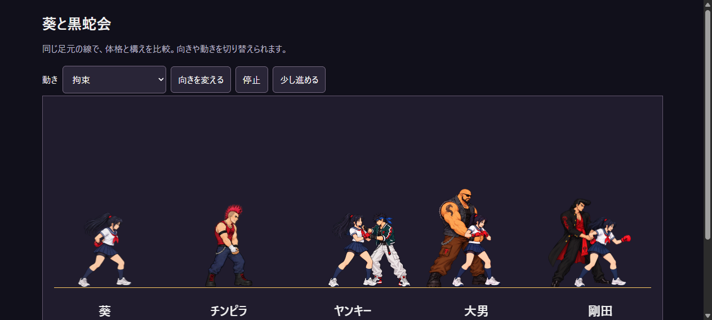
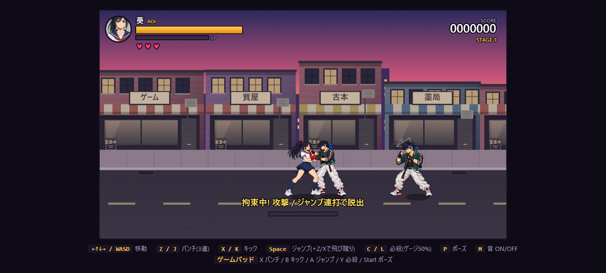
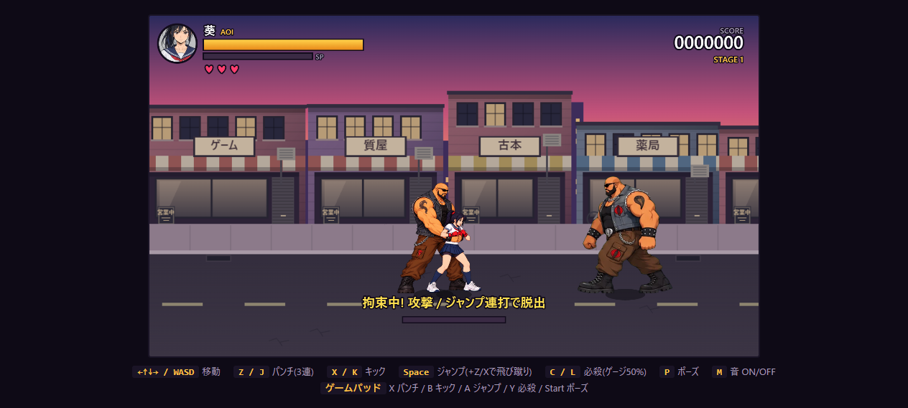
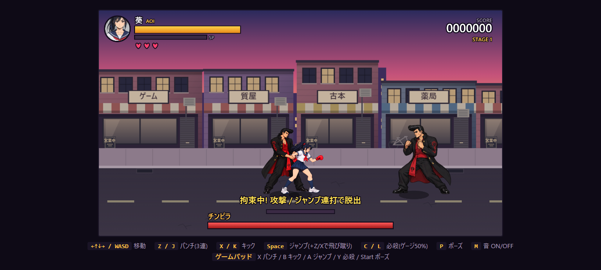
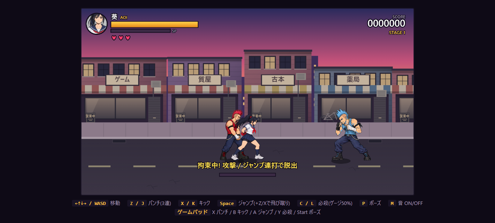
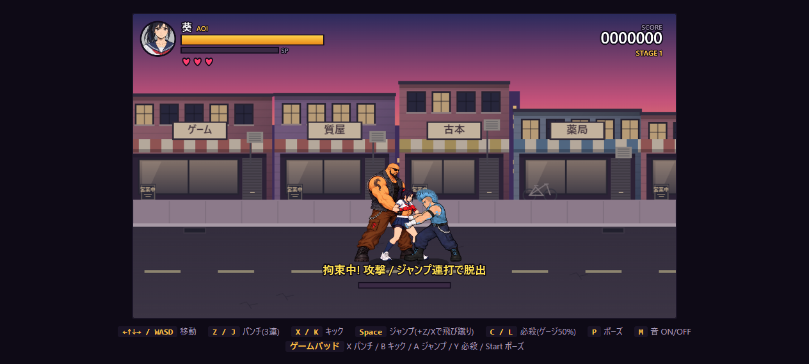

# 敵別の拘束

| 敵 | 成立する位置 | 専用の姿勢 |
| --- | --- | --- |
| チンピラ | 葵の背後 | 従来の後ろ手で両手首を押さえる。マウントも継続 |
| ヤンキー | 葵の正面 | 襟元の布をつかむ。葵は相手の腕を押し返す |
| デカブツ | 葵の背後 | 両腕で胴を抱え込む。葵は腕を引き離そうとする |
| 番長・剛田 | 葵の背後 | 片腕の手首と肘を押さえる。葵のもう片腕は前へ伸ばす |

チンピラは背後のパンチから必ず拘束へ移行。他の3種は条件を満たす攻撃選択時に25%で選ぶ。
予告文字・予備動作なし、拘束自体のダメージなし、最大180更新と8回の新規入力での脱出は共通。
被弾中も拘束を維持し、拘束者の被弾・撃破・ステージ切替では解除する。
ゲームオーバー時も各種が成立し、解除後はダウンへ戻る。

ヤンキーの襟つかみは正面を占有するため追加拘束は行わず、他の敵は通常攻撃する。
他の拘束では従来の腹パン4発を継続。胴・片腕拘束の葵は前へ乗り出さないため、追加の敵が近づく距離を短くし、拳の接触を合わせる。

新しい3種は葵と敵を1枚にまとめ、手の接触・重なりを固定した静止画を小さく周期振動させる。
葵の足元と体格を基準に正規化し、デカブツと番長だけの体格を素材で調整した。
正面ヤンキーは同じ青緑ジャケットを使い、色調整の範囲を敵側に限る。
描画は組の中で完結し、他の敵への透過処理や画面全体の消去を使わない。
解除後はチンピラ以外が旧後ろ手ポーズに戻ることを避け、通常の構えへ戻す。

原本・[正確な生成/編集プロンプト](../source_art/character-v2/hold-pairs-provenance.json)・[足元とサイズの計測値](../source_art/character-v2/hold-pairs-layout.json)を保存。
`python tools/pack_hold_pairs.py` で切り抜き・透明化・パックを再現できる。
元画像・アトラスのハッシュは `assets/characters/hold-pairs-validation.json` に記録。
ゲームとキャラクター比較画面の拘束モードに反映。

## 確認

Node 60件・Python 11件、合計71件を確認。
新しい回帰確認は敵4種の左右・成立位置・AIでの発動・脱出・中断・保護中の拒否・HP0・追加拘束4発・描画の重複防止・画像の透明度/寸法/ハッシュを対象とする。

別のローカルブラウザーで拘束選択済みAIの実更新から4種を成立させ、通常の構えを横に置いて体格と服色を比較。新素材3種は左右両方を確認。
デカブツ拘束でチンピラが腹パン4発、HP100→76、終了後ダウンを確認。ボスの拘束は実キーZの8回入力で脱出を確認。ブラウザーエラーなし。CIは未設定。

