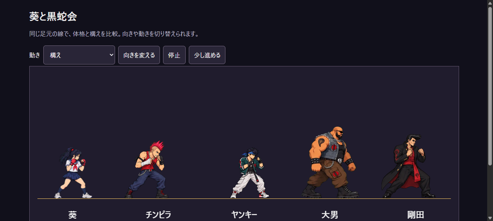
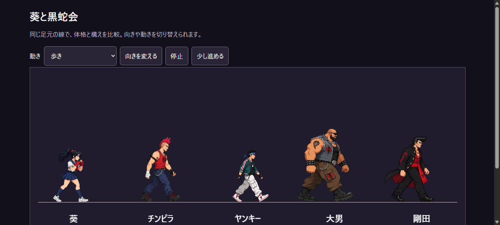
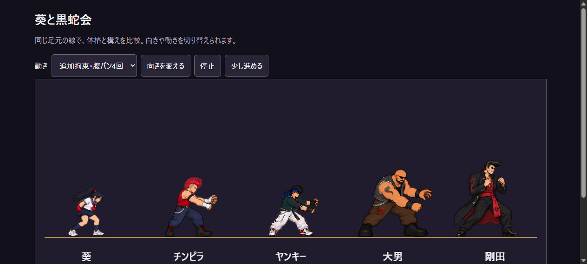
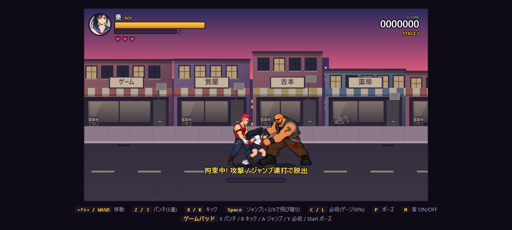
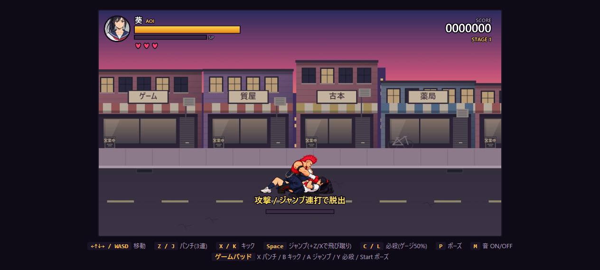

# モーション間の体格の統一

歩き・通常攻撃・ジャンプ/必殺技・被弾・ダウン/起き上がり・後ろ手拘束・腹パン・マウントの画像を、接地線を揃えた一覧で比較した。
各キャラの通常の構えに対する頭・肩・胴体のサイズを基準にする。拳を上げる、膝を曲げる、寝ると画像全体の高さが変わるため、全高を同じにする調整は行わない。

大きく見えていた追加拘束・マウント、ヤンキーの歩き、ボスの歩き/突進/叩きつけを補正した。
葵のジャンプも軽く補正。通常攻撃と被弾・ダウンの既存素材は一覧で確認し、基準となる倍率を維持した。

| 対象 | 修正前に対する表示倍率 |
| --- | --- |
| 葵の追加拘束 | 88% |
| 葵のジャンプ・必殺技 | 約96% |
| チンピラの追加拘束 | 90% |
| マウント・タックル | 82% |
| ヤンキーの歩き | 約91% |
| ヤンキーの後ろ手拘束 | 約93% |
| ヤンキーの追加拘束 | 約86% |
| デカブツの後ろ手・追加拘束 | 82% |
| ボスの歩き・突進・叩きつけ | 84% |

倍率は `sprite-scale.js` に集約し、ゲームとキャラクター比較画面で共用する。敵それぞれの体格倍率はその後に適用する。
マウントは葵と敵が一組なので、両者を同じ倍率で補正する。マウントの命中エフェクト位置も補正倍率を反映する。

`python tools/audit_sprite_scale.py <出力先>` で全アトラスの比較画像を再作成できる。`--baseline` を付けると修正前の倍率で出力する。画像の描き直しやモーションの変更は行っていない。

## 確認

- 全キャラのアトラス一覧を目視確認。
- 比較画面で構え・歩き・追加拘束の切替を確認。
- ゲーム画面で通常表示、拘束とデカブツの腹パンの接触位置、マウント時の体格を確認。
- Node 56件、Python 10件が通過。ブラウザーエラーなし。

