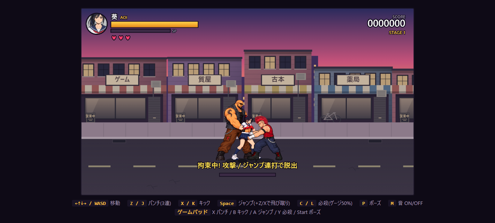
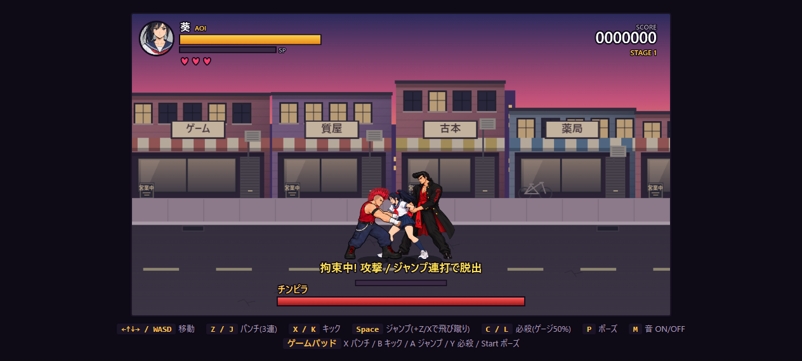
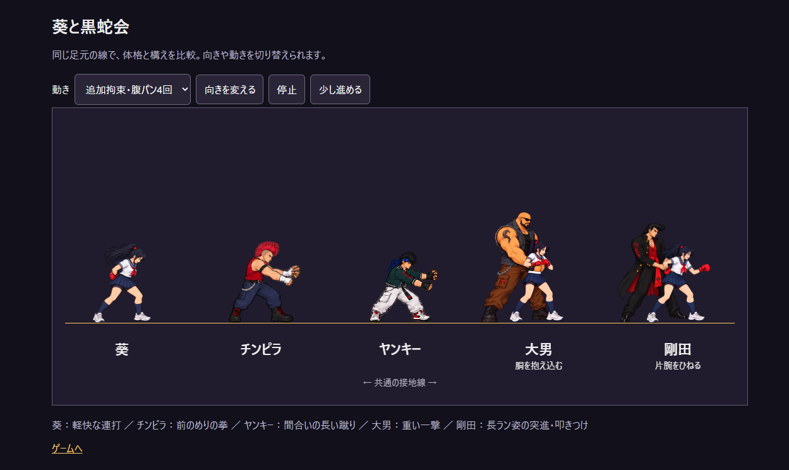

# キャラクター全体の見直し（2026-10-11）

葵・チンピラ・ヤンキー・大男・剛田の歩行、通常攻撃、被弾、ダウン、起き上がり、拘束、追加攻撃、マウントの素材を共通の接地線・ゲーム内の倍率で確認した。屈みや横倒しで高さが変わる部分は、身長に合わせて拡大せず、その姿勢を保つ。

## 修正

- 大男・剛田の専用拘束は、腹パンを受けても静止したままだった。4回の命中それぞれに、攻撃者から離れる方向へ最大3pxの反動を加え、12フレームで戻す。１枚絵の倍率・回転・手の接触位置は変更しない。
- 比較画面の腹パン表示が、大男に旧拘束素材を使い、剛田は通常立ち姿になっていた。実際の専用拘束と同じ絵・反動を表示するよう修正した。
- 縮尺確認ツールに3種類の専用拘束を追加。葵を基準に登録した絵なので、敵の倍率を再度掛けない。

ヤンキーの服色統一、チンピラ拘束中の葵の接地、マウントの同じ腕による打撃を確認し、今回それらの素材や倍率は変更していない。

## 確認

- ブラウザで大男の右向き拘束と剛田の左向き拘束を再現し、前方のチンピラによる命中時を確認。
- 実際の更新処理で4発の追加攻撃を進め、HP100→76、拘束解除後にダウンすることを確認。
- 比較画面の10表示を切り替え、ブラウザ例外なし。
- Node 62件、Python 11件の計73件が成功。

再現はデバッグ用の固定配置。敵の自然な出現頻度を測る長時間の通しプレイではない。

