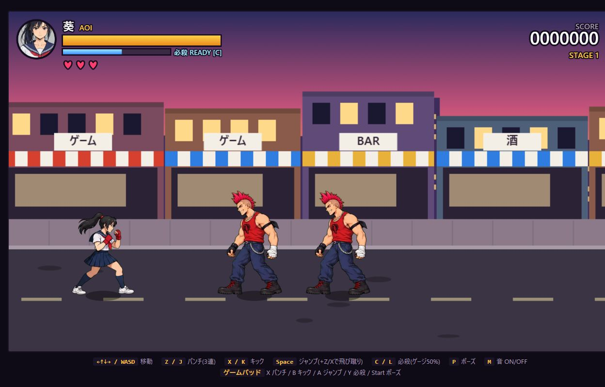
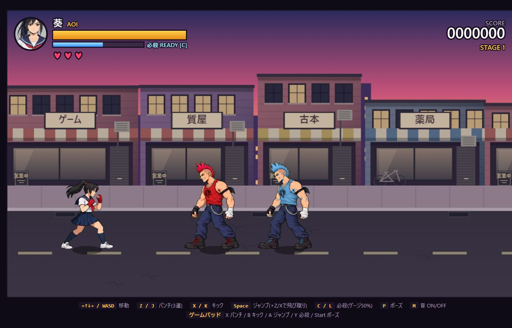
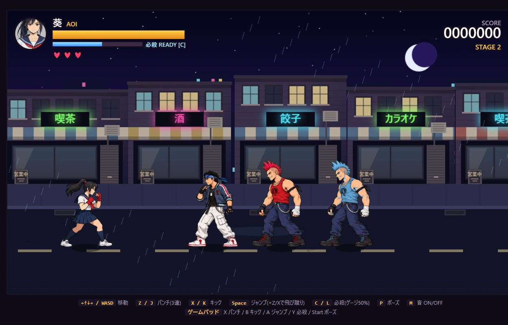
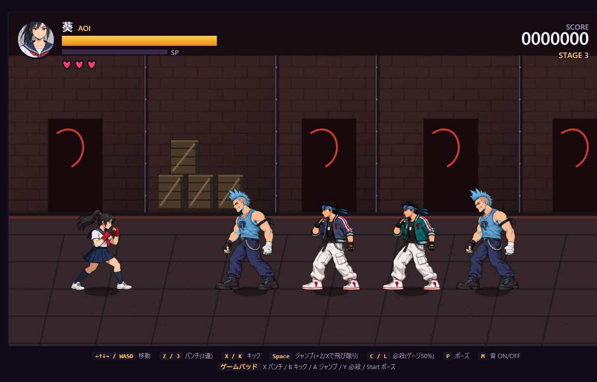
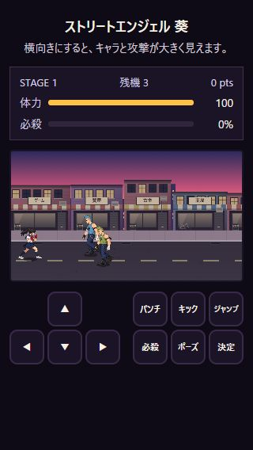
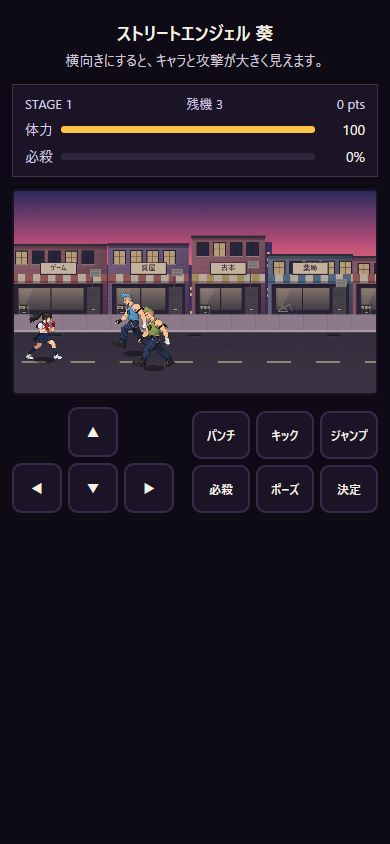
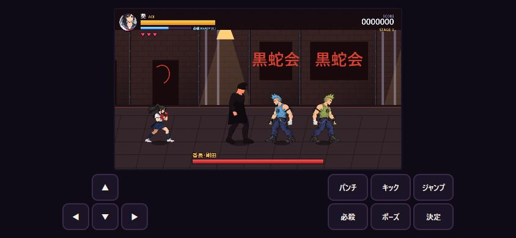

# 見た目の改善と確認 (2026-10-10)

## 対応内容

- 店舗の窓枠、壁の陰影、ガラス、シャッター、室外機、看板、自転車を描画。ひさしと窓の色を抑えてキャラを見やすくした。
- 路面の影に似た楕円形の汚れを、ひび割れと排水溝に変更。アジトにもレンガの段違い、木箱の板と筋交い、柱の鋲を追加。
- チンピラ・ヤンキーを各3色に。肌色・輪郭・透明度・陰影を保つ色変換を読み込み時に一度だけ行い、歩行と戦闘で同じ色を使用。敵ごとに動きの開始位置もずらした。
- 幅600px以下では体力・残機・スコア・必殺ゲージをHTMLで表示し、ゲーム内の小さな重複表示を省略。ボスの体力バーは維持。
- 縦画面の上余白を削減し、横向きの案内を追加。狭い縦画面と高さの低い横画面でもタッチ操作を配置。

## 確認結果

`node --test tests/visual-style.test.cjs`: 3件成功。肌色・白・輪郭・透明画素の保持、色違いの区別、陰影・アルファの保持、対象外キャラを変更しないことを確認。

Codex内ブラウザで以下を確認。タッチ端末はブラウザのタッチエミュレーションを使用。

| 確認 | 結果 |
| --- | --- |
| デスクトップ 1280×800、3ステージ | 背景・敵・体力表示が描画される |
| チンピラ・ヤンキーの歩行／戦闘シート | 各シート3色を読み込み、待機・歩行・予備動作・攻撃・被弾・ダウン・起き上がりを描画 |
| ボス戦 | 既存3Dボス、2D敵、ボス体力バーを確認。小画面でも体力バーを確認 |
| タッチ縦画面 320×568／334×884／390×844 | 横はみ出しなし。外側の体力表示を確認。最終320×568では操作部下端約460px、ボタン最小44px |
| タッチ横画面 844×390 | 横はみ出しなし。操作部下端約377px、ボタン最小44px |
| 通常URL (`?debug`なし) | タッチの「決定」から開始。デバッグAPIが公開されないことを確認 |
| コンソール | 通常起動と描画確認時にアプリ由来のエラー・警告なし |

デスクトップの比較画像はデバッグAPIでステージ・配置・体力を揃え、撮影専用タブのアニメーションを止めて取得。撮影専用タブは終了済み。敵の出現乱数や動作位相は完全に固定していないため、厳密な画素差による回帰判定には使用しない。専用 `.game-dev/adapter.json` はなく、sealed run・GPU性能計測は実施していない。

物理スマホでの操作感、全ステージの通常プレイによるクリアは未確認。既存ボスは3Dマネキンのまま。歩行素材自体の足の入れ替わりの限界も残る。

## 比較画像

### 改善前

### 改善後

### 小画面

