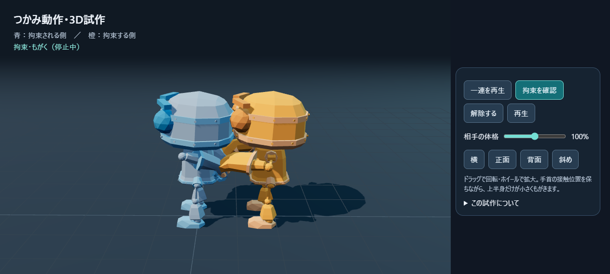
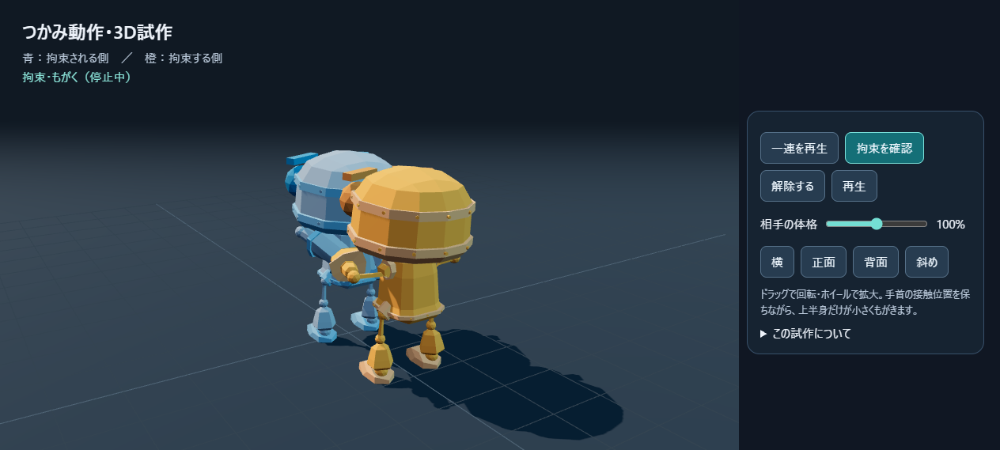

# つかみ動作の3D試作

起動中のプレビュー: http://127.0.0.1:8766/grapple-3d/

ゲーム本体と独立した画面。無料の骨組み付きモデル２体で、背後からつかむ → 後ろ手拘束 → 小さくもがく → 解除を10秒周期で試す。モデル・描画ライブラリはローカル保存してあり、表示時のCDNアクセスは不要。

## 操作

- 「一連を再生」: 接近から解除まで繰り返す。
- 「拘束を確認」: 拘束状態を維持してもがく。
- 「解除する」: 拘束姿勢から手を離して後退する。
- 「停止／再生」: 動きを止めて角度を確認。
- 相手の体格85〜115％、横・正面・背面斜め・斜めのカメラ、ドラッグ回転とズーム。

## 素材と利用条件

RobotExpressive: Tomás Laulhé / Quaternius、Don McCurdyによる変換等。CC0 1.0。

- [配布元のモデルと利用条件](https://github.com/mrdoob/three.js/tree/r180/examples/models/gltf/RobotExpressive)
- [モデル原本](models/RobotExpressive.glb)
- [配布元README](models/LICENSE.md)
- [CC0本文](models/CC0-1.0.txt)

Three.js 0.180.0: MIT、[同梱ライセンス](vendor/three/LICENSE)。必要なモジュールだけを同梱。既存ゲームの描画ライブラリは変更していない。

ダウンロード元URL・SHA-256・ファイルサイズは [assets.lock.json](assets.lock.json)。モデルは原本を保存し、色・サイズ・姿勢のみ実行時に変更する。

## 確認結果（2026-10-12）

- ブラウザでGLBを読み込み、独立した２体として描画。
- 体格85％・100％・115％について6秒間を20Hzで確認（計363姿勢）。追従用の手の骨と相手手首の指定接触点との最大距離は0.000001m未満。
- 10秒周期の待機・接近・拘束・解除と、一周後の状態を確認。
- 実際のボタン操作と、390×844の画面サイズでも表示を確認。
- ブラウザ例外なし。周期・IKの到達範囲と骨長の維持・GLB構造のテストあり。

この数値は指定した骨の接触点の追従誤差であり、指先やメッシュ表面が自然に密着していることの証明ではない。

## 判断できること／今後の調整

共通の骨組みを使うと、２体の接触点を保ちながら動かせる。姿勢ごとに別画像を生成せず、カメラ角度と体格を変更できる。

一方、このロボットは人間と頭身・腕の比率が違う。人間モデルに替える際は、関節の曲がる方向と可動域、指の握り、肩・胴・衣服の貫通、足と床の接触を再調整する必要がある。現在は上半身の位置合わせの試作で、衝突判定や物理拘束、指の握り込み、攻撃・ダウンの動作は実装していない。既存2Dゲームへの採用は未実施。

